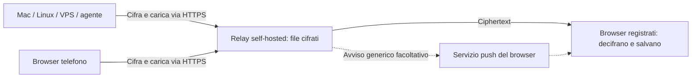

# RelayDrop

**Una casella cifrata tra i tuoi dispositivi, utilizzabile anche dagli agenti AI.**

[English](README.en.md) · [Primi passi](docs/GETTING_STARTED.md) · [Installazione HTTPS](docs/DEPLOYMENT.md) · [Agenti](docs/AGENT_INTEGRATION.md) · [Sicurezza](SECURITY.md)

Invia un documento dal Mac, un risultato da una VPS o una foto dal telefono. Ritrovalo nella stessa casella sul dispositivo che ti serve, anche su un’altra rete. Un agente come Codex può usare la CLI o la skill inclusa per consegnarti un file quando glielo chiedi.

**Versione 0.6.1, MVP self-hosted, licenza MIT.** RelayDrop è un nome provvisorio. Il progetto è pensato per uso personale e piccoli gruppi fidati; l’interfaccia è attualmente in italiano. Non è un sistema di backup e non è stato sottoposto a un audit di sicurezza indipendente.

## Cosa fa

- **Browser su telefono e computer:** ricezione senza app obbligatoria. Per gli avvisi iPhone si aggiunge la web app alla Home.
- **Invio rapido:** scegli un file, scatta una foto o trascina un file nella pagina. La scelta avvia subito l’invio.
- **Casella condivisa:** i nuovi file sono accessibili ai browser registrati; quelli precedenti si sincronizzano quando apri un browser che può già leggerli. Non devi scegliere un destinatario per ogni invio personale.
- **Recenti in cima:** ricerca, filtri, badge locale «Nuovo», scadenza leggibile e download diretto. Riepilogo e dettagli sono azioni separate.
- **Cifratura sul mittente:** contenuti, nomi e riepiloghi vengono cifrati prima dell’upload. Il relay conserva ciphertext e metadati operativi.
- **Avvisi Web Push facoltativi:** testo generico, senza nome o contenuto del file. Gli invii dal browser escludono il browser mittente dagli avvisi.
- **CLI/API per agenti:** output JSON, destinatario autenticato e skill Codex inclusa. Nessuna lettura AI automatica dei file.
- **Conservazione per file:** temporanea, fino a una data e ora, oppure senza scadenza se abilitata dall’amministratore. Modificabile nei dettagli dai proprietari degli invii e dall’admin; file conservati senza limite di download.
- **Accesso mantenuto:** circa 90 giorni di inattività sui dispositivi personali; opzione di otto ore per quelli condivisi.

## Come funziona



Il mittente può scollegarsi dopo l’upload. Non occorre che i dispositivi siano online contemporaneamente. Serve un relay raggiungibile via HTTPS; non è necessario aprire porte sul telefono o sul computer del destinatario.

## Parti da qui

| Obiettivo | Guida |
|---|---|
| Provare sul proprio computer | [Primi passi](docs/GETTING_STARTED.md) |
| Usare telefono e computer su reti diverse | [VPS, HTTPS e servizio persistente](docs/DEPLOYMENT.md) |
| Capire accessi, impostazioni e notifiche | [Guida utente](docs/USER_GUIDE.md) |
| Chiedere a Codex «inviami questo file» | [Skill e CLI per agenti](docs/AGENT_INTEGRATION.md) |
| Integrare un altro client | [API](docs/API.md), [OpenAPI](docs/openapi.json) |
| Allegare riepiloghi locali facoltativi | [AI locale e notifiche](docs/LOCAL_AI_AND_NOTIFICATIONS.md) |

Ogni installazione usa il proprio dominio, storage e credenziali. Il progetto non offre un relay pubblico condiviso e non richiede l’accesso all’istanza dell’autore.

## Tre accessi diversi

| Accesso | A cosa serve |
|---|---|
| **Personale / recipient** | Stessa credenziale sui propri dispositivi: invio nella propria casella, ricezione, registrazione browser, notifiche. |
| **Agente / uploader** | Credenziale dedicata per inviare da CLI/API a un’identità destinataria; vede i propri invii. |
| **Amministratore** | Configura limiti globali e consulta i metadati operativi. È l’unico accesso con la scheda **Impostazioni**. |

Se «Impostazioni» non compare, non manca una pagina: sei entrato con un accesso personale o agente. Per i limiti globali usa la credenziale amministrativa generata durante l’installazione. Le preferenze del singolo browser restano in **Dispositivi e avvisi**. Il ruolo amministratore non concede le chiavi private dei file degli altri utenti.

## Durata e dimensioni

| Aspetto | Comportamento attuale |
|---|---|
| Upload web | Minore fra 100 MiB e il limite configurato; cifratura in memoria |
| Upload CLI | Cifratura a flusso su temporaneo cifrato; limite amministrativo, tetto tecnico circa 2 GiB |
| Spazio iniziale | 1 GiB, 1.000 trasferimenti; modificabili dall’amministratore |
| Invio web predefinito | Fino a 24 ore e 20 download, entro la policy del servizio |
| Conservazione facoltativa | Data entro la durata massima, oppure senza scadenza; nessun limite di download. Richiede abilitazione admin |
| Invio CLI senza opzioni | 1 ora e 3 download, entro la policy |
| Skill inclusa | Legge durata e avvisi dalla propria configurazione privata |
| Browser registrati | Massimo 4 per identità |
| Registro attività | Default 30 giorni, massimo 2.000 eventi; non contiene nomi o contenuti in chiaro |

Alla scadenza il file non è più accessibile. Il server rimuove i file scaduti con cleanup ogni minuto; rimuove anche quelli revocati o con download esauriti. Un download interrotto consuma un tentativo. Un file già salvato sul dispositivo non viene eliminato dal cleanup del relay.

## Cosa sapere prima di usarlo

Un browser aggiunto dopo l’invio riceve le chiavi dei file ancora disponibili quando apri RelayDrop su un browser della stessa identità che può già leggerli. La sincronizzazione è cifrata e automatica; lascia la casella visibile per circa un minuto per pochi file. Se tutte le chiavi locali sono perse, serve il link originale o un nuovo invio. Safari e l’app sulla Home possono avere archivi separati. Cancellare i dati del browser può eliminare le chiavi locali.

Il server vede identità, dimensioni cifrate, orari, scadenze ed eventi. La directory delle chiavi pubbliche e il JavaScript servito dal relay sono fidati: un server attivamente compromesso può sostituirli. Per questo non promettiamo protezione contro un relay malevolo. Leggi [il modello di sicurezza](SECURITY.md).

Non sono ancora presenti ripresa degli upload, sincronizzazione cartelle, recupero delle chiavi, account self-service, MFA, scansione antivirus o una coda durevole delle notifiche. Un avviso accettato dal provider non prova che il dispositivo lo abbia ricevuto; il trasferimento completato non prova la lettura del file.

## Verifica e contributi

```sh
npm ci --ignore-scripts
npm run check
npm test
```

49 test automatici verificati sul Mac di sviluppo e nella CI Linux/macOS con Node 22/24. Prova reale iPhone riuscita su rete cellulare: invio, avviso anche ad app chiusa, apertura e salvataggio; provati anche foto dal telefono verso Mac e invio tramite skill. La matrice CI verifica Node 22/24 su Linux/macOS e un job dedicato prova installazioni systemd e Docker da zero, trasferimento HTTPS e persistenza dopo riavvio; gli esiti sono disponibili in [GitHub Actions](https://github.com/alessandroserpe/relaydrop/actions/workflows/test.yml). Android, fotocamera del nuovo pulsante, trascinamento nativo e grandi file su telefoni restano da collaudare. [Dettagli delle verifiche](docs/VALIDATION.md).

[Contribuire](CONTRIBUTING.md) · [Licenza MIT](LICENSE) · [Alternative e trade-off](docs/ARCHITECTURE.md)
