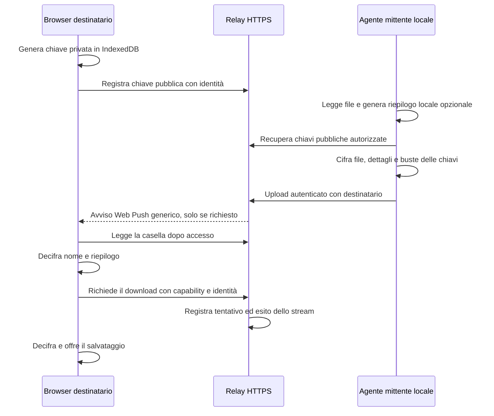

# Ricerca e architettura

Fonti primarie consultate il 30 ottobre 2026. Le funzionalità sono documentate dai progetti; non sono stati installati o sottoposti a benchmark in questa sessione.

| Opzione | Cosa risolve | Valutazione per questo MVP |
|---|---|---|
| [croc](https://github.com/schollz/croc) | CLI multipiattaforma, PAKE, relay self-hostable, ripresa e client browser documentato | Ottimo per trasferimenti con mittente online. Il modello di sessione non coincide con una cassetta temporanea asincrona. Non è corretto scartarlo sostenendo che non abbia un client web. |
| [PairDrop](https://github.com/schlagmichdoch/PairDrop) | Browser, pairing e stanze tra reti, TURN, integrazione CLI documentata | Ottimo per scambi interattivi; il ricevente partecipa alla sessione. STUN/TURN e signaling aumentano la superficie operativa per il caso asincrono. |
| [Send + ffsend](https://github.com/timvisee/ffsend) | Upload cifrato, link browser, scadenza, limiti, CLI automatizzabile, host personalizzato | Alternativa più vicina, da preferire se l’obiettivo è adottare un servizio esistente. Il nuovo MVP risponde alla richiesta di una repository autonoma con API minima e comportamento verificabile. Non ne reimplementa il protocollo e non è compatibile con ffsend. |
| [LocalSend](https://github.com/localsend/localsend) | Scambio tra dispositivi nella rete locale | Ottimo sulla LAN; il requisito fondamentale qui è raggiungere reti diverse e ricevere in differita. |

Repository del server Send: [timvisee/send](https://github.com/timvisee/send). Non viene dedotto lo stato di manutenzione dalla sola disponibilità del README.

## Decisione aggiornata: casella privata 0.3

Il relay asincrono rimane la base; il valore del prodotto è ora nella gestione di file, identità, attività e riepiloghi cifrati. La dashboard risponde a cosa è disponibile e chi ha avviato o completato un trasferimento. I file scaduti sono rimossi, mentre il registro conserva eventi per un periodo configurabile.

La richiesta dell’utente ha stabilito il confine AI: un agente locale legge i contenuti, il relay conserva solo ciphertext per file, nomi e riepiloghi. Ogni browser destinatario registra una chiave pubblica; la CLI incapsula la chiave del file per i browser registrati. La dashboard decifra i metadati localmente, permette la ricerca e raccoglie i riepiloghi in una vista dedicata.

## Trade-off

- **Asincronia:** il mittente può scollegarsi; il relay paga spazio e banda, anziché richiedere sessioni P2P contemporanee.
- **Identità:** token individuali e ruoli migliorano attribuzione e isolamento. Non sono MFA/OIDC e non provano chi fisicamente usa una credenziale. Link anonimi restano distinti.
- **Dashboard privata:** nome e summary non sono indicizzabili sul server. Un browser non registrato prima dell’invio richiede il link originale o un nuovo invio. Non esiste recupero server delle chiavi perse.
- **Sicurezza del relay:** cifratura a riposo non protegge da un relay malevolo che sostituisce JavaScript o chiavi pubbliche. Nessuna key transparency o verifica indipendente delle chiavi implementata.
- **Dimensioni:** CLI a flusso e spool cifrato su disco; limite scelto dall’amministratore, default 100 MiB e tetto tecnico circa 2 GiB. Il browser continua a decifrare in memoria. Non si promette funzionamento di file enormi su tutti gli iPhone.
- **Persistenza:** metadati e stato di controllo JSON con fsync/rename, contatori prima dello stream e prenotazioni quota. Un solo writer; niente cluster, database distribuito o S3.
- **Registro:** 30 giorni di default, massimo 2.000 eventi; niente log IP o contenuti. Non immutabile, non prova di lettura. Un crash può lasciare un download senza evento conclusivo.
- **AI locale:** contenuti non inviati dal programma a servizi cloud; Ollama deve essere attivo e locale. Formati ed estrazione limitati, nessuna scansione automatica di cartelle. Riepiloghi soggetti a errore e verificabili sul documento.
- **Avvisi:** Web Push integrato e opt-in, senza segreti dei file nel payload. Web app sulla Home per iPhone, permesso esplicito, chiavi VAPID private sul server. ntfy resta adattatore opzionale; dipendenza dai servizi push dei browser documentata.
- **Cancellazione:** revoca blocca nuove richieste, non copie già ricevute. Un file unlinked può occupare spazio fino alla chiusura degli stream. Ridurre la quota non elimina retroattivamente file attivi.

Riferimenti: [Node crypto](https://nodejs.org/api/crypto.html), [Web Crypto](https://developer.mozilla.org/en-US/docs/Web/API/SubtleCrypto/decrypt), [Ollama generate](https://docs.ollama.com/api/generate), [ntfy](https://docs.ntfy.sh/publish/), [Web Push iOS](https://webkit.org/blog/13878/).

Prima di un servizio pubblico: audit indipendente, pinning delle chiavi, OIDC/MFA, quote per utente, coda notifiche durevole, cifratura chunked revisionata per file grandi, backup/recovery delle chiavi, test fisici e di carico. Nessuna superiorità di sicurezza rispetto ai progetti esistenti viene presunta.
